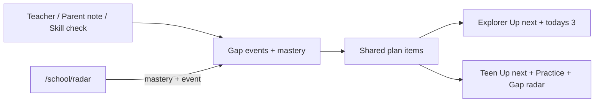

# School dashboard (Explorer and Teen)

One School product, two age skins. Same data. Different layout.

**When:** after deploy and the first Founding Tester week — see `docs/NEXT_STAGE_NOTES.md` (next-stage item 11 / Jorge’s list item 10). Do not start this before the public test link is live and the first week of feedback is in.

**Already done elsewhere (PR #14):** GLM-5.3 Flash default path, explain-after-answer, parent session count, owl art frames, CI green on new UI. Do not rebuild those here.

---

## Who builds what

### Your build (this plan — after first feedback)

1. Shared plan-item model + gap-events store (all ages).
2. Explorer School home: big Up next with owl, today’s 3 with pictures, one Quick check door.
3. Teen School home: Up next, Practice | Gap radar tabs, intro sheet; remove Skill check duplicate.
4. EN/AR copy for the above, 390px screenshots, self-critique pass.

Do **not** include here: homework photo upload, provider/env keys, Report-a-problem (that’s first tester week), Supabase.

### Later (not this plan)

Homework upload (camera / library / PDF), vision model, guide-never-solve + decline log, parent “sees subject only” toggle. After accounts / stronger safety story.

---

## Shared mental model (both ages)

```
Gap radar   = map of what needs work
              (teacher recommendations, parent notes, skill checks)
Practice    = work the skills the plan lists, in order
Skill check = short quiz that updates the gap map
Homework    = later (guide, never solve)
```

**Up next** = first unfinished plan item. Explorer “today’s 3”, Teen “Your plan”, and Gap radar bars all read the same plan.

**Source chips**
- Teacher ← `oneLiner`
- Parent note ← `unitNote` keyword hits
- Skill check ← shaky/unknown mastery + dated gap events

---

## Age skins

| | Explorer (~7–10) | Teen (~11–17) |
|---|---|---|
| Tone | Chunky, owl-forward, pictures | Compact, calm, structured |
| Up next | Large card + owl + one Start | Dense card + source chips + one Start |
| Rest of plan | “Today’s 3” picture tiles | Practice tab: ordered list, quiet Open |
| Gap map | One Quick check door | Gap radar tab + Take a skill check |
| Intro | Keep first visit simple | Bottom sheet once, reopen from ? |
| Homework | Not in this plan | Not in this plan |

Skill check stays at [`/school/radar`](src/app/school/radar/page.tsx). No second Skill check card on either home.

Use shipped owl frames from PR #14 for Explorer Up next / look-again.

---

## ASCII wireframes (390px)

### Explorer
```
┌────────────────────────────────┐
│ ←  School                      │
│ This week for Alex · Year 3    │
│                    [owl]       │
├────────────────────────────────┤
│ Up next                        │
│ [ big skill picture ]          │
│ Halves and quarters            │
│ Short kid reason               │
│ [ Start practice ]             │
├────────────────────────────────┤
│ Today's 3                      │
│ [pic] Halves  [pic] Measure    │
│ [pic] Living things            │
├────────────────────────────────┤
│ [ Quick check ]                │
└────────────────────────────────┘
```

### Teen — home + Up next
```
┌────────────────────────────────┐
│ ←  School                    ? │
│ Hi Alex · Year 7 (age 11–12)   │
├────────────────────────────────┤
│ Up next                        │
│ Percentages · ~8 min           │
│ [Teacher] Teacher asked for…   │
│ [ Start practice ]             │
├────────────────────────────────┤
│ [ Practice | Gap radar ]       │
└────────────────────────────────┘
```

### Teen — Practice tab
```
│ Your plan                      │
│ Ordered by teacher + gap radar │
│ 1 Percentages    Math [Teacher]│
│                         [Open] │
│ 2 Simple algebra Math [Check]  │
│                         [Open] │
│ 3 Cells…         Sci  [Parent] │
│                         [Open] │
```

### Teen — Gap radar tab
```
│ Needs work │ Building │ Strong │
│ ████       │ ██       │ █      │
│ Where this comes from          │
│ · Teacher · 10 Nov · fractions │
│ · Skill check · 9 Nov · shaky  │
│ Empty: No skill check yet…     │
│ [ Take a skill check ]         │
```

### Teen intro (once / ?)
```
│ How School works               │
│ 1 Gap radar shows skills that  │
│   need work (teacher, parent,  │
│   skill checks).               │
│ 2 Practice works those skills  │
│   one at a time.               │
│ [ Show me my plan ]            │
```

---

## Critique (before build)

- Shared plan is the point: one model, two skins. Do not fork focus-picking per age.
- Explorer home changes (Up next + today’s 3); practice/radar question flows stay.
- Teen drops Skill check tab/door duplicate; Explorer keeps one Quick check door.
- No homework in this pass.
- Teen gap visual = mastery bars, not a decorative radar chart.
- Gap events need dates for “Where this comes from.”
- Build only after Founding Tester week so real “where kids get lost” notes shape the chrome.



---

## Implementation (when this stage starts)

### 1. Shared plan — [`src/lib/school-plan.ts`](src/lib/school-plan.ts)
```ts
type PlanSource = "teacher" | "parent" | "skillCheck";
type PlanItem = {
  skillId: SkillId;
  subject: "math" | "science";
  minutes: number;
  status: "todo" | "doing" | "done";
  sources: PlanSource[];
  reason: string;
};
```
- `buildSchoolPlan(profile, mastery, gapEvents)` → 3–5 items (calm → 1–2).
- Order: teacher/parent first, then shaky skill-check, then grade defaults.
- `upNext` = first unfinished item.
- Tests: `tests/unit/school-plan.test.ts`.

### 2. Gap events — [`src/lib/demo-store.ts`](src/lib/demo-store.ts)
- `wondrix-gap-events`: `{ id, at, kind, skillId?, summary }[]` (cap ~40).
- Write on skill-check completion and when parent saves `oneLiner` / `unitNote`.
- Teen intro flag: `wondrix-teen-school-intro:{nickname}`.

### 3. Explorer home — `ExplorerSchoolHome`
- [`src/app/school/page.tsx`](src/app/school/page.tsx) when `ageMode === "explorer"`.
- Big Up next + owl + single Start practice.
- Today’s 3 picture tiles from the same plan.
- One Quick check door → `/school/radar`.

### 4. Teen home — `TeenSchoolHome`
- When `ageMode === "teen"`.
- Header, ?, Up next, tabs Practice | Gap radar.
- Source chips; filled CTA only on Up next / Take a skill check.
- Remove Practice | Skill check segment and bottom Skill check door.

### 5. Teen intro — [`src/components/BottomSheet.tsx`](src/components/BottomSheet.tsx)
- Two steps. No homework step.

### 6. Copy + shots + critique
- EN + AR: `school.plan.*`, `school.explorer.*`, `school.teen.*`, `school.intro.*`.
- Screenshots at 390px for both ages.

---

## Files (this stage)

- New: `school-plan.ts`, `ExplorerSchoolHome.tsx`, `TeenSchoolHome.tsx`, `BottomSheet.tsx`, unit tests
- Edit: `school/page.tsx`, `radar/page.tsx` (emit gap event), `demo-store.ts`, `en.ts`, `ar.ts`
- Out of scope: provider env, homework API, Report-a-problem, Supabase
