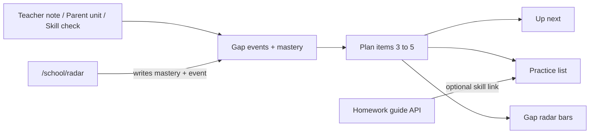

# Teen School dashboard redesign

## Design plan (short)

**Goal:** Teen School reads as one loop — Gap radar finds gaps → Practice works them → Skill check refreshes the radar — with Homework as a guide-only side path.

**Locked decisions**
- Branch on `profileAgeMode === "teen"` only. Explorer keeps the current mascot + dual-CTA layout in [`src/app/school/page.tsx`](src/app/school/page.tsx).
- Tabs are in-page state on `/school` (`practice` | `radar` | `homework`). Skill check stays at [`/school/radar`](src/app/school/radar/page.tsx) and is launched only from Gap radar’s primary CTA (no Skill check tab, no duplicate door card).
- One shared plan model drives Up next, Practice list, and Gap radar bars so they cannot disagree.
- Source chips: `oneLiner` → Teacher; `unitNote` keyword hits → Parent note; shaky/unknown mastery + dated skill-check events → Skill check.
- Homework uses a new guide-never-solve API; declines are logged. Parent toggle under Safety & visibility: see upload happened + subject (default on), never content.

### ASCII wireframes (390px)

**Shell + Up next (all tabs)**
```
┌────────────────────────────────┐
│ ←  School                    ? │
│ Hi Alex · Year 7 (11–12)       │
├────────────────────────────────┤
│ UP NEXT                        │
│ Percentages · ~8 min           │
│ [Teacher] Teacher asked for…   │
│ [ Start practice ]  ← only     │
│                     filled CTA │
├────────────────────────────────┤
│ [ Practice | Gap radar | Hw ]  │
│         segmented control      │
└────────────────────────────────┘
```

**Practice tab**
```
│ Your plan                      │
│ Ordered by teacher + gap radar │
│ 1 Percentages  Math [Teacher]  │
│                        [Open]  │
│ 2 Simple algebra Math [Check]  │
│                        [Open]  │
│ 3 Cells…       Sci  [Parent]   │
│                        [Open]  │
```

**Gap radar tab**
```
│ Needs work │ Building │ Strong │
│ ████       │ ██       │ █      │  ← compact bars
│ Where this comes from          │
│ · Teacher · 10 Nov · fractions │
│ · Skill check · 9 Nov · shaky  │
│ Empty: No skill check yet…     │
│ [ Take a skill check ]         │
```

**Homework tab**
```
│ Upload homework                │
│ [ Camera ] [ Photos ] [ PDF ]  │
│ large 44px+ targets            │
│ --- after analyze ---          │
│ Where to look                  │
│ Topic → skill [ Open practice ]│
│ Concepts to review · ask teach │
│ [ I tried it, check my method ]│
│ Past uploads · date · subject  │
│ Parent can see subject only.   │
```

**Intro sheet (once / ?)**
```
│ How School works               │
│ 1 Gap radar = map of gaps      │
│ 2 Practice = work one skill    │
│ 3 Homework = guide, never solve│
│ [ Show me my plan ]            │
```

### Plan critique (before build)
- **Good:** One primary CTA + shared plan kills the dual-Start / duplicate Skill check confusion.
- **Risk:** Homework AI will try to solve — mitigate with hard system prompt, refuse+log path, and a local fallback that only maps topic→skill and never writes steps.
- **Risk:** Tall Parent-style scroll under absolute nav — reuse the `wx-shell-main` + `wx-bottom-pad` pattern already fixed.
- **Scope cut that stays honest:** Radar visual is horizontal bars by mastery state (not a full SVG radar chart) so the tab stays calm and scannable on 390px.
- **Data gap:** Mastery alone has no dates — add a small gap-events log when skill checks finish and when parent saves notes, or sources look “timeless.”



## Implementation

### 1. Plan item model — [`src/lib/school-plan.ts`](src/lib/school-plan.ts) (new)
```ts
type PlanSource = "teacher" | "parent" | "skillCheck";
type PlanItem = {
  skillId: SkillId;
  subject: "math" | "science";
  minutes: number;       // fixed estimates by skill band (e.g. 6–10)
  status: "todo" | "doing" | "done";
  sources: PlanSource[];
  reason: string;        // plain sentence from sources, no jargon
};
```
- `buildSchoolPlan(profile, mastery, gapEvents)` returns 3–5 items (calm mode → 1–2).
- Order: teacher/parent hits first, then shaky skill-check, then grade defaults.
- `upNext` = first `status !== "done"`.
- Unit tests in `tests/unit/school-plan.test.ts` for ordering, sources, and empty reason copy.

### 2. Gap events store — [`src/lib/demo-store.ts`](src/lib/demo-store.ts)
- Key `wondrix-gap-events`: `{ id, at, kind, skillId?, summary }[]` (cap ~40).
- Write on skill-check completion (radar page) and when parent saves `oneLiner` / `unitNote`.
- Intro flag: `wondrix-teen-school-intro:{nickname}` (per student nickname).

### 3. Teen UI — extract [`src/components/school/TeenSchoolDashboard.tsx`](src/components/school/TeenSchoolDashboard.tsx)
[`page.tsx`](src/app/school/page.tsx) becomes: if explorer → keep existing JSX; if teen → `<TeenSchoolDashboard />`.
- Header: back via AppShell, title “School”, `?` opens intro sheet.
- Greeting: name + `gradeNameWithAge` (e.g. Year 7 (age 11–12)).
- Up next card + segmented control + tab panels.
- Source chips as compact bordered pills (not filled accent).
- Only Up next / Gap radar “Take a skill check” / Homework analyze use filled `wx-cta`; Practice rows use quiet border buttons (“Open”).

### 4. Intro bottom sheet — [`src/components/BottomSheet.tsx`](src/components/BottomSheet.tsx)
- Accessible dialog (role=dialog, focus trap light, Escape closes after seen).
- First Teen School visit auto-opens; `?` reopens; “Show me my plan” sets seen flag.

### 5. Homework flow
- UI in Teen dashboard Homework tab.
- Store: `wondrix-homework` list `{ id, at, subject, topic, skillId?, fileName, previewDataUrl?, guide, deleted? }`.
- API [`src/app/api/school/homework/route.ts`](src/app/api/school/homework/route.ts):
  - `analyze` — subject/topic/skill + where-to-look card; system rule guide-never-solve; on solve-request → refuse, append decline log, return safe redirect copy.
  - `checkMethod` — feedback on approach only, no final answer; same decline log.
- Decline log: `wondrix-homework-declines` + server `[agent] homework.decline …` for testability.
- Upload: `<input capture>` + file picker (`image/*`, `application/pdf`); multi-page = multiple files in one session.
- Local fallback if AI down: keyword map file name / optional caption → skill; static “where to look” tips (never steps).

### 6. Parent setting
- `ParentProfile.parentSeesHomeworkMeta?: boolean` default `true`.
- Toggle under Safety & visibility in [`parent/page.tsx`](src/app/parent/page.tsx).
- Day summary / parent glance: if true and uploads exist, one line “Homework uploaded: {subject}” — never body text.

### 7. i18n
- New `school.teen.*`, `school.homework.*`, `school.intro.*`, `parent.homeworkMeta*` keys in [`en.ts`](src/lib/i18n/en.ts) + [`ar.ts`](src/lib/i18n/ar.ts).
- Sentence case, no em dashes, active verbs; empty states included.

### 8. Screenshots + self-critique pass
- Browser at 390px width, Teen + dark mode: Practice, Gap radar, Homework (empty + result), intro sheet.
- Critique pass checklist: one primary CTA, no Skill check duplicate, sources visible, Explorer unchanged, Safety/homework privacy line, decline log fires on a forced “solve this” prompt, AA contrast on chips/fields.

## Files touched (expected)
- New: `school-plan.ts`, `TeenSchoolDashboard.tsx`, `BottomSheet.tsx`, `api/school/homework/route.ts`, homework helpers, unit tests
- Edit: `school/page.tsx` (branch only), `radar/page.tsx` (emit gap event), `demo-store.ts`, `types.ts`, `parent/page.tsx`, `en.ts` / `ar.ts`
- Do not redesign Explorer branch, practice question UI, or Wonder
